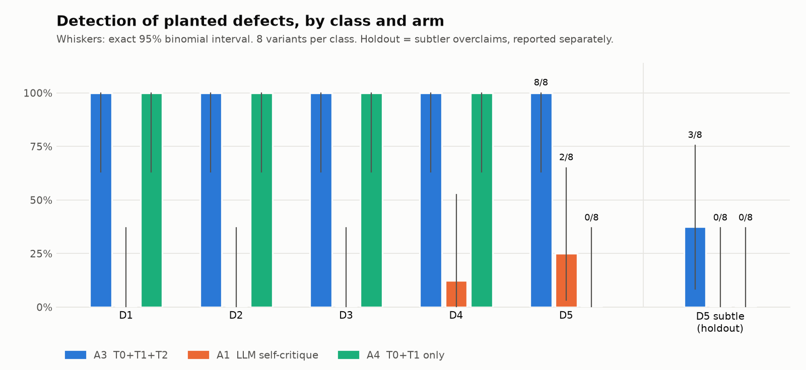
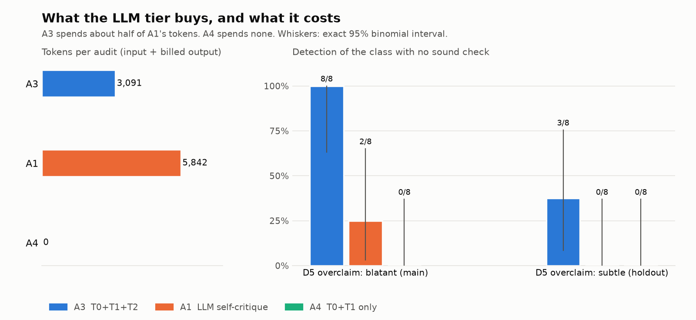
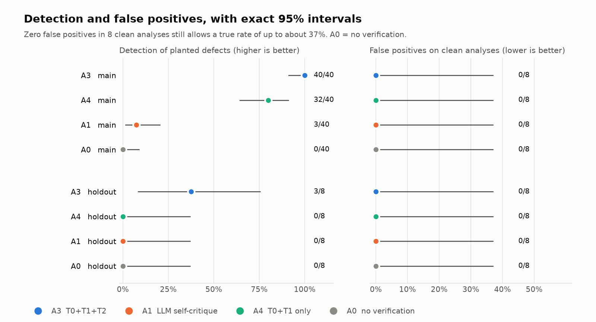

# Kilter

**Tells you whether your analysis is in kilter, and shows you what it checked.**

*In kilter: in proper working order, correctly adjusted.*

An LLM (or a rushed human) can write a cheminformatics analysis that runs, reports a high AUROC, draws a pretty plot,
and is statistically invalid. Kilter audits an existing analysis script and answers one of three things:

| Verdict | Meaning |
|---|---|
| `IN KILTER` | No defect found by any tier that ran. The checks that ran are listed, so a pass is never silent. |
| `OUT OF KILTER` | A defect was found: its class, `file:line`, the evidence, and **which tier caught it**. |
| `ESCALATE` | Not enough evidence to decide; says what a human should look at. |

It is tiered on purpose. Sound, deterministic checks run first; an LLM critic runs last and only where no sound check
exists (for example, a conclusion that claims more than its numbers support).

```
T0  static analysis of the code (Python AST)       sound    leakage, split protocol, multiple comparisons
T1  runtime assertions on the data it actually used sound    duplicates across the split, scaffold overlap
T2  LLM critic, isolated from the author            unsound  does the conclusion exceed the numbers?
```

Kilter **audits** analyses. It does not write them.

## Quickstart (30 seconds)

```bash
python -m venv .venv && source .venv/bin/activate        # Windows: .venv\Scripts\Activate.ps1
pip install -e ".[agent,dev]"
python -c "from kilter.data import load_dataset as l; l('bace'); l('bbbp')"   # one-time download, about 300 KB
kilter demo                                              # offline, no API key, identical output every time
kilter audit demo/2_leakage_bbbp.py --data bbbp --no-llm # deterministic tiers only
```

To use the LLM critic, copy `.env.example` to `.env` and set `GOOGLE_API_KEY` (Google AI Studio, free tier is enough).
`kilter audit ... --report report.md` also writes a report that exists after the terminal closes.

## An example

`kilter audit demo/2_leakage_bbbp.py --data bbbp`, output as printed:

```
+--------------------------------------------------------------------------------------------------+
|                                           OUT OF KILTER                                          |
+------------------------------- At least one tier found a defect. --------------------------------+
script  2_leakage_bbbp.py
arm     A3  T0 + T1 + T2

 x D1  Test-set leakage into preprocessing
     caught by  T0 static   T2 critic   2_leakage_bbbp.py:61  critic confidence 1.00
     Preprocessing is fit on data that includes the test partition (leakage, REF-1).
     evidence: `prep.fit(X, y)`: `X` is the full array, also partitioned as `X[tr_idx]` (line 62), ...

checks run   leakage . split-protocol . multiple-comparisons . duplicates . scaffold-overlap . critic
cost         3,067 in / 192 out tokens . 1.9s LLM time . free tier, list price not configured
```

## Results

Evaluation: 8 clean analyses and 8 analyses for each of five defect classes (D1 preprocessing leakage, D2 duplicate
molecules across the split, D3 split protocol unstated or random where novel scaffolds are claimed, D4 multiple
comparisons without correction, D5 conclusion overclaims). Two reference analyses (BACE and BBBP, ECFP + RandomForest /
XGBoost) with four benign configurations each. Defects are **planted**, so ground truth is exact. One evaluation pass,
one verifier code hash, one model (`gemini-3.5-flash-lite`, free tier). Intervals are exact binomial 95%.

**Headline: the full pipeline (A3) found 40 of 40 planted defects (91-100%) with 0 false alarms in 8 clean analyses.
The deterministic tiers alone (A4) found 32 of 40 (64-91%). An LLM reviewer that critiques itself, with no tiers (A1),
found 3 of 40 (2-20%) while spending 1.9x A3's tokens.**

| arm | D1 | D2 | D3 | D4 | D5 | false positives | all defects |
|---|---|---|---|---|---|---|---|
| A0 no verification | 0/8 | 0/8 | 0/8 | 0/8 | 0/8 | 0/8 | 0/40 (0-9%) |
| A1 LLM self-critique | 0/8 | 0/8 | 0/8 | 1/8 | 2/8 | 0/8 | 3/40 (2-20%) |
| **A3 T0+T1+T2** | 8/8 | 8/8 | 8/8 | 8/8 | 8/8 | 0/8 | **40/40 (91-100%)** |
| A4 T0+T1 only | 8/8 | 8/8 | 8/8 | 8/8 | 0/8 | 0/8 | 32/40 (64-91%) |

| arm | LLM calls / audit | input tokens | billed output tokens |
|---|---|---|---|
| A1 | 2 | 5,573 | 270 |
| A3 | 1 | 2,914 | 176 |
| A4 | 0 | 0 | 0 |





**What the LLM tier added.** Nothing on D1-D4 (A3 and A4 are both 8/8; the critic is shown the tier findings and mostly
agrees). On D5, the class with no sound check, it added 8 of 8 (exact paired test, 8 vs 0 discordant, p = 0.008).
That is the architecture working as designed, and it is the only class where the LLM earns its cost.

**The harder test.** The 8 D5 overclaims above are blatant ("proves", "replace the assay"). I then wrote a holdout of
8 subtle overclaims and 8 confident-but-honest conclusions, pre-registered with the critic prompt frozen
(`AIMS/decisions.md` D-018). Reported separately, never pooled:

| holdout | D5 subtle | false positives |
|---|---|---|
| A3 | 3/8 (9-76%) | 0/8 |
| A4 | 0/8 | 0/8 |
| A1 | 0/8 | 0/8 |

The critic caught overclaims that can be checked against the printed numbers ("better", "meaningful", "differs")
and missed every claim that goes *beyond* the data (generalisation to new series, an invented benchmark, an untested
mechanism). The A3 vs A4 difference on the holdout is not statistically significant at n = 8 (p = 0.25).

**Phase 2: can a scope-claim prompt close that gap? Partly, not proven.** I wrote a second, fresh holdout (8 beyond-the-data
overclaims, 8 confident-but-honest conclusions; `AIMS/decisions.md` D-022) before writing the new prompt, then ran the
frozen prompt and the scope prompt (`src/kilter/core/tiers/t2_scope.py`, a three-sentence edit of the frozen one) on it.
Holdout 1 was not used to tune anything. Same model, temperature 0, one call each:

| holdout 2 | beyond-the-data D5 (95% CI) | false positives on honest-confident (95% CI) |
|---|---|---|
| frozen prompt | 4/8 (16-84%) | 0/8 (0-37%) |
| scope prompt | 7/8 (47-100%) | 0/8 (0-37%) |

The paired exact test (3 overclaims only the scope prompt caught, 0 the other way) gives p = 0.25: at n = 8 the improvement
is not statistically distinguishable from chance. All 7 scope-prompt detections name the beyond-the-data statement, and
false positives did not rise. The one miss is an untested-mechanism claim with a nearby non-significant result.
The frozen prompt also caught 4/8 here against 3/8 on holdout 1, so holdout 2 may be somewhat easier; the two holdouts
are not comparable. The scope prompt is a separate variant, not wired into A3: every Phase 1 number above is unchanged.

**Self-critique made the reviewer worse (exploratory).** The recorded first response of A1, a critic with no tiers and
no self-critique, found D1 5/8, D3 4/8, D4 5/8, D5 7/8; after A1's second "critique your own review" turn it found
0, 0, 1 and 2. This matches Stechly et al. [REF-7] on our own data. It cannot see duplicates at all (D2 0/8): that
needs a runtime check, which is what T1 is for. This was not a pre-registered arm and should be read that way.

Full tables with the exploratory rows: `results/results_table.md`. All 256 run records: `results/phase1.json`.

## Limitations

Read these before relying on any number above.

- **The defects are planted, not found in the wild.** My injectors and my checkers share naming heuristics and I wrote
  both, so 100% on D1-D4 partly measures agreement between two components. A second reference written in a different
  style and a holdout reduce this; they do not remove it. A real-world held-out set is the missing test.
- **Small n.** 8 per class. 8/8 is compatible with a true rate of 63% (exact interval). The holdout A3-vs-A4
  difference is not significant.
- **The critic confirms numbers, not scope.** It missed 5 of 8 subtle overclaims, all claims beyond the data.
  The prompt probably steers it there. I did not tune the prompt on the holdout, so it is untouched. A scope-claim prompt
  tested on a fresh holdout caught 7/8 against 4/8 for the frozen prompt with no extra false positives (0/8 each), but
  p = 0.25 at n = 8, one author wrote the claims and the prompt, and it is not in the audit path. The gap is narrowed in
  the data, not demonstrated closed.
- **It never abstains.** Critic confidence sits at 0.95-1.00 on every finding, so the `ESCALATE` path fired 0 times
  and the abstention-calibration curve carries no information. `ESCALATE` is wired and tested but unexercised.
- **One weak model on a free tier.** `gemini-3.5-flash-lite`. The stronger model's free tier is 20 requests a day,
  which could not carry the evaluation. The critic's contribution here is therefore a lower bound for stronger models.
  Critic output was recorded at temperature 0, one sample per audit; run-to-run variance of fresh calls was not
  measured. Results replay from the recorded responses in `fixtures/llm/`.
- **Audit mode, one domain, one hook contract.** Kilter audits molecular-property-prediction scripts that expose
  `run`, `load_dataset` and `auroc_for` (see `AIMS/decisions.md` D-010). A script without them gets `ESCALATE`, not a
  pass. T1 and the artifact step execute the audited script, so only audit code you trust: there is no sandbox.
- **Judgement calls.** A near-duplicate counts as a defect at 1% of the test set (my judgment, not literature);
  below that it is reported as informational. BBBP itself contains such pairs. Critic conviction thresholds
  (0.70 convict, 0.40 escalate) are also my judgment.
- **Split choice is flagged, never ruled on.** Kilter reports an unstated protocol and, with `--sensitivity`, how far the
  metric moves across protocols (here random 0.893, randomised scaffold 0.875, deterministic scaffold 0.782 on BACE).
  It does not claim one protocol is correct [REF-17, REF-18].
- **Run records carry a content digest, not a signature.** Edits are detectable; authorship is not.
- A2 (critic alone as a separate arm), scRNA-seq, generation mode and a UI are out of scope for Phase 1.

## Reproduce

```bash
python scripts/build_artifacts.py          # execute every variant once (about 30 min; cached by script hash)
python scripts/run_eval.py                 # all arms, both sets, from recorded LLM responses (about 10 min, offline)
python -m kilter.eval.figures              # the three figures
pytest                                     # 40+ tests; set KILTER_LLM_MODE=replay to run fully offline
```

`KILTER_LLM_MODE` is `record` (default: read-through cache), `replay` (never calls the API) or `live`.

## Layout

```
src/kilter/core/       findings, T0 static, T1 runtime, T2 critic, adjudicator, run records
src/kilter/graph/      the LangGraph pipeline (Loader -> T0 -> T1 -> T2 -> Adjudicator -> Report)
src/kilter/defects/    taxonomy, AST injectors D1-D4, hand-authored D5, holdout
src/kilter/eval/       arms, metrics with exact CIs, figures
references/            the two verified-clean analyses
fixtures/              recorded LLM responses and artifacts (the offline demo and evaluation replay these)
docs/blueprint.md      the design, with every decision numbered and its falsifier stated
docs/TALK.md           the five-minute script and the six questions
AIMS/                  decisions, mistakes, learnings, open questions
tracker/index.html     project status
```

## References

Kapoor and Narayanan, *Leakage and the reproducibility crisis in machine-learning-based science*, Patterns 2023 [REF-1];
Stechly, Valmeekam and Kambhampati, *On the self-verification limitations of LLMs*, ICLR 2025 [REF-7];
Wu et al., *MoleculeNet* [REF-14]. Full list in `docs/blueprint.md` section 12.
